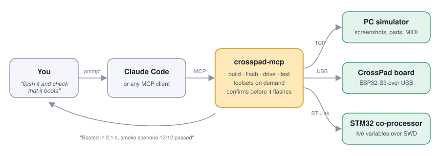
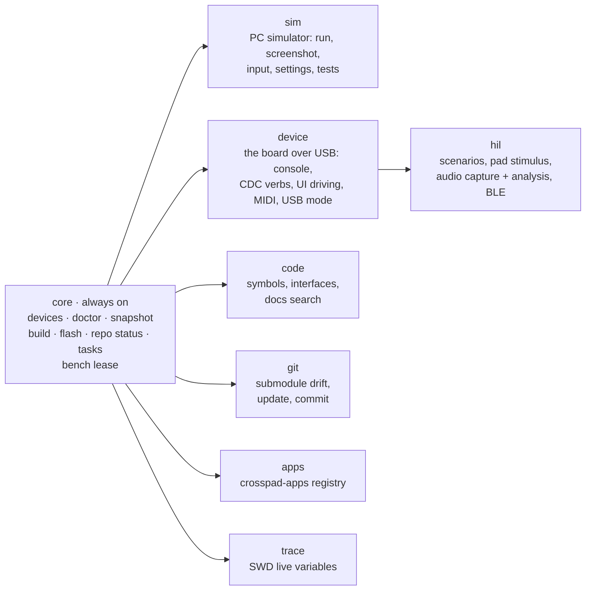

# crosspad-mcp — usage reference

The complete reference for `crosspad-mcp-server`: every install path, every
toolset and tool, resources, prompts, configuration, transports and the v10
migration table. If you are new here, start with
[What you can do with it](#what-you-can-do-with-it) below. The CrossPad SDK
docs are at https://crosspad.app/docs/; their
[MCP tools page](https://crosspad.app/docs/reference/mcp-tools/) is the public
version of the tool list here.

**52 tools in 8 toolsets (12 visible at start) · 15 resources · 6 prompts · 3 bundled Claude Code skills · stdio & HTTP transports**

**Contents:** [What you can do with it](#what-you-can-do-with-it) ·
[Install](#install) · [Skills](#skills-start-here) ·
[Tools + resources](#tools--resources) · [Configuration](#configuration) ·
[Transport](#transport) · [How it works](#how-it-works) ·
[Development](#development)

## What you can do with it

**Talk to your CrossPad. Let Claude do the toolchain.** You say *"flash the
new build and check that it boots"*; the server runs the ESP-IDF build, asks
you to confirm the flash, opens the console, runs the smoke scenario and tells
you what happened — with the hardware traps already built in, so you don't
have to remember which serial port reboots the board when you open it.

<p align="center">
  
</p>

Every row is a real prompt. The tools named underneath are what runs — you
never have to call them yourself.

| Say this… | …and this happens |
|---|---|
| **"Build the firmware and flash it over OTA."** | `crosspad_build platform=idf` streams the build, `crosspad_flash transport=ota` asks for confirmation, then streams the upload. New app directories are detected and the `fullclean` is done for you. |
| **"Show me what's on the simulator screen."** | `crosspad_run` launches the PC sim, `crosspad_screenshot` returns the LCD as an image Claude can actually look at. Then *"press pad 5"*, *"turn the encoder left twice"* — `crosspad_input`. |
| **"Play a drum pattern on the pads and record what comes out."** | `crosspad_stimulus` hits the pads with real timings, `crosspad_capture` records the board through its own USB-audio endpoint, `crosspad_analyze` gives a verdict (onsets, clicks, silence, velocity curve). |
| **"Why did it crash?"** | `crosspad_diagnose_crash` — reset reason, registers, backtrace decoded against the ELF that is *actually* flashed, heap after restart. One call. |
| **"Watch the battery charger state machine while I plug the cable in."** | `crosspad_trace` polls STM32 variables live over ST-Link without halting the core, and plots them. |
| **"Install the sampler app and rebuild."** | `crosspad_apps_install app_name=sampler` adds the submodule from the [crosspad-apps](https://github.com/CrossPad/crosspad-apps) registry, then a clean build. |
| **"Where is `IPadLogicHandler` implemented?"** | `crosspad_interface_implementations` across every repo of the ecosystem, or `crosspad_symbol` for clangd-precise definitions and call hierarchies. |
| **"Is my board even connected?"** | `crosspad_devices` and `crosspad_doctor` — which USB mode it is in, which ports belong to it, what is missing on the host, and how to fix each thing. |

Only the `core` toolset is visible when the server starts, so the tool list
stays small. Claude enables the others as the conversation needs them — or you
start the server with `--toolsets device,sim`.



Anything that writes to a device or your host is tiered. Flashing, DFU and
SWD writes come back as *confirmation required* first; `--read-only` removes
every writing tool from the list entirely. Long operations (builds, flashes,
scenarios) run as tasks you can check on, wait for or cancel.

**Who is it for**

- **You build and drive CrossPad firmware** — mostly the simulator, sometimes
  the board. Start with the [user guide](../skills/crosspad/reference/role-user.md).
- **You work on the firmware itself** — flash, console, HIL scenarios, crash
  diagnosis, SWD. Read the [firmware developer guide](../skills/crosspad/reference/role-fw-dev.md)
  and [HIL testing](../skills/crosspad/reference/hil-testing.md).
- **You want to extend this server** — the
  [contributor guide](../skills/crosspad/reference/role-contributor.md) and the
  [Development section](#development).

## Install

Install a local copy and launch it with `node`. Never launch it through `npx`:
npx's own startup output breaks the stdio channel
(`MCP error -32000: Connection closed`).

```bash
npm i --prefix ~/.local/crosspad-mcp crosspad-mcp-server@latest
claude mcp add -s user crosspad -- node ~/.local/crosspad-mcp/node_modules/crosspad-mcp-server/dist/index.js
```

Or with custom repo paths:

```bash
claude mcp add -s user crosspad \
  --env CROSSPAD_IDF_ROOT=/path/to/platform-idf \
  --env CROSSPAD_PC_ROOT=/path/to/crosspad-pc \
  -- node ~/.local/crosspad-mcp/node_modules/crosspad-mcp-server/dist/index.js
```

Restart Claude Code and the tools are available. Re-run the `npm i` line to
update. On Windows use `$HOME\.local\crosspad-mcp` in both paths. Step by step,
with the crosspad-hil setting: https://crosspad.app/docs/how-to/hil-testing/#from-claude-code-optional;
fixes: https://crosspad.app/docs/troubleshooting/#mcp. Every other variant
(developing this repo, tracked `.mcp.json`, scopes) is in
[`skills/crosspad/reference/install.md`](../skills/crosspad/reference/install.md).

### Alternative: `.mcp.json` in your project

Add to your repo root — Claude Code picks it up automatically. A tracked file
is shared with everyone who clones the repo, so it carries no personal paths
(`${HOME}` is expanded per user; nested `${A:-${B}}` is not):

```json
{
  "mcpServers": {
    "crosspad": {
      "type": "stdio",
      "command": "node",
      "args": ["${HOME}/.local/crosspad-mcp/node_modules/crosspad-mcp-server/dist/index.js"]
    }
  }
}
```

Per-machine repo paths go in local scope, which wins over the file:
`claude mcp add -s local crosspad --env CROSSPAD_IDF_ROOT=/path/to/platform-idf -- node ~/.local/crosspad-mcp/node_modules/crosspad-mcp-server/dist/index.js`.

### Alternative: Claude Desktop

Edit `~/Library/Application Support/Claude/claude_desktop_config.json` (macOS) or `%APPDATA%\Claude\claude_desktop_config.json` (Windows):

```json
{
  "mcpServers": {
    "crosspad": {
      "command": "node",
      "args": ["/absolute/path/to/.local/crosspad-mcp/node_modules/crosspad-mcp-server/dist/index.js"],
      "env": {
        "CROSSPAD_IDF_ROOT": "/path/to/platform-idf"
      }
    }
  }
}
```

## Skills (start here)

This package ships three Claude Code skills (bundled in the `crosspad` plugin):

- **`crosspad`** — the entry point. An ecosystem map, install/config guide, per-role
  guides (user / firmware dev / server contributor), a tool cheat-sheet, and an FAQ.
  A fresh agent should read this first. Lives at `skills/crosspad/SKILL.md`;
  run `bash skills/crosspad/scripts/doctor.sh` to check your environment.
  Reference guides bundled with it:
  - `reference/philosophy.md` — the CrossPad design principles ("write once, run
    everywhere", thin platform repos) and where code belongs
  - `reference/hil-testing.md` — hardware-in-the-loop testing on the real device:
    the flash→smoke workflow, the crosspad-hil scenario map, the CDC/SysEx remote
    control surface, and the hardware traps that cost real debugging sessions
  - `reference/repos.md`, `reference/tools.md`, `reference/install.md`,
    `reference/faq.md`, per-role guides
- **`swd-tracer`** — real-time SWD variable tracing for CrossPad r20 (STM32G0B1)
  over ST-Link (see the SWD tracing section below).
- **`before-after`** — proof that a change did or did not move the UI or cost
  frames: per-app simulator screenshots plus an `LVGL_STATS` benchmark on the board.

Install them by symlinking `skills/<name>` into `~/.claude/skills/`, or as a
plugin (`/plugin marketplace add CrossPad/crosspad-mcp`, then
`/plugin install crosspad@crosspad`). The plugin also adds its own `crosspad`
server entry, which next to a `node` registration means a failed or a second
server — how to avoid that:
[Skills, and the plugin's second server](../skills/crosspad/reference/install.md#skills-and-the-plugins-second-server).
The server also serves the skill pages as `skill://` resources.

## Tools + resources

> v10 put the tools behind **toolsets** and a **policy**: `tools/list` starts with the `core` toolset only, so the startup context stays small, and everything that writes to a device or the host is tiered and confirmable. Migration table at the bottom of this file.

Each tool is focused on a single action. Strict schema validation (ranges on MIDI/pad values, enums on platforms/repos) catches bad inputs before execution.

### Toolsets

| Toolset | Contains | On at start |
|---|---|---|
| `core` | `crosspad_devices`, `crosspad_doctor`, `crosspad_snapshot`, `crosspad_build`, `crosspad_flash`, `crosspad_repo_status`, `crosspad_toolsets`, `crosspad_task`, `crosspad_confirm`, `crosspad_bench_claim`, `crosspad_bench_release`, `crosspad_bench_status` | yes |
| `device` | `crosspad_cdc`, `crosspad_console`, `crosspad_ui`, `crosspad_midi`, `crosspad_usb_mode`, `crosspad_audio_route`, `crosspad_diagnose_crash` | no |
| `hil` | `crosspad_hil_run`, `crosspad_hil_triage`, `crosspad_capture`, `crosspad_analyze`, `crosspad_stimulus`, `crosspad_ble` | no |
| `sim` | `crosspad_run`, `crosspad_kill`, `crosspad_check`, `crosspad_screenshot`, `crosspad_input`, `crosspad_stats`, `crosspad_settings_get`, `crosspad_settings_set`, `crosspad_test_run`, `crosspad_log` | no |
| `code` | `crosspad_docs_search`, `crosspad_architecture`, `crosspad_symbol`, `crosspad_search_symbols`, `crosspad_list_interfaces`, `crosspad_interface_implementations`, `crosspad_capabilities`, `crosspad_list_apps_source` | no |
| `git` | `crosspad_repo_diff`, `crosspad_submodule_update`, `crosspad_commit` | no |
| `apps` | `crosspad_apps`, `crosspad_apps_list`, `crosspad_apps_install`, `crosspad_apps_remove`, `crosspad_apps_update`, `crosspad_apps_sync` | no |
| `trace` | `crosspad_trace` | no |

Enable one at runtime with `crosspad_toolsets action=enable toolset=device` (the tool list changes and the client is notified). At startup: `--toolsets device,code` (or `CROSSPAD_TOOLSETS=device,code`, keyword `all`). `--read-only` (or `CROSSPAD_MCP_POLICY=readonly`) removes every non-`read` tool from the list regardless of toolset flags — read-only always wins.

Danger-tier tools (`crosspad_flash`, bootloader/DFU requests, `crosspad_trace` write/call) return `resultType="confirmation_required"` with a `confirm_token` valid for 120 s; re-issue the identical call carrying the token to proceed. A declined confirmation is `CANCELLED_BY_USER` and must not be retried automatically.

### Build & flash

| Tool | Purpose |
|------|---------|
| `crosspad_build` | Build for `platform: pc\|idf\|stm` (`mode`: incremental/clean, plus reconfigure for PC/STM, fullclean for IDF; `build_type` for PC/STM) |
| `crosspad_run` | Launch built simulator (`platform: pc`), return PID + post-spawn TCP readiness probe |
| `crosspad_kill` | Stop running simulator (`platform: pc`, SIGTERM by exe name match) |
| `crosspad_check` | Health check (`platform: pc`): stale exe, new sources, submodule drift |
| `crosspad_flash` | Flash firmware (`target: esp` with `transport: uart\|ota`, or `target: stm` with `method: swd\|dfu`) |
| `crosspad_log` | Capture simulator logs (`target: pc` spawns the binary). For device logs use `crosspad_console` — it does not reboot the board. |
| `crosspad_devices` | Devices through the crosspad-hil daemon: USB mode, CDC + STM32-bridge ports, MIDI ports, UAC2 card, which one is selected |
| `crosspad_trace` | Real-time SWD variable trace over ST-Link (non-halting RAM polling) |
| `crosspad_audio_route` | Runtime codec routing on the physical device over MIDI SysEx (ADC inputs, DAC outputs, USB-mic source, volume/mute, query) |

### Shared bench (toolset `core`)

Several sessions share one board, and opening its CDC port for a moment, or
flashing it, breaks whoever is mid-test. crosspad-hil keeps a **lease** per
board — one holder, a queue behind it, what firmware the last holder left on
it, expiry after a ttl without renewal — in one file every session's daemon
shares (`~/.local/state/crosspad-hil/bench.json`).

| Tool | Purpose |
|------|---------|
| `crosspad_bench_claim` | Take the board (`granted`) or join the queue (`position`, and who holds it until when). Claiming while holding renews. `force` takes it from a holder that is gone — logged |
| `crosspad_bench_release` | Give it back with `firmware_left` (what is on the board now); the head of the queue has 10 minutes to claim |
| `crosspad_bench_status` | Holder, ETA, queue, the firmware left on the board, recent history (releases, expiries, overrides) |

Once a session has claimed, this server sends its holder name with every
daemon op, so every tool that touches the board is checked against the lease
and renews it; another session's call is refused with `BENCH_BUSY`, naming the
holder and their ETA. `crosspad_flash` (uart, STM `swd`/`dfu`) and
`crosspad_trace` (`start`/`write`/`call`/`device_state`) touch the board
outside the daemon and ask `bench.check` first. A board nobody has claimed is
not gated. Needs crosspad-hil ≥ 1.6.0; an older daemon has no lease and
nothing is refused. For a first rollout, `CROSSPAD_BENCH_MODE=warn` in the
server's environment (the daemon inherits it) logs refusals instead of acting
on them; `off` checks nothing.

### Device (crosspad-hil daemon)

Everything here needs a connected board (`[ESP HW]`) and the `device` toolset.

| Tool | Purpose |
|------|---------|
| `crosspad_doctor` | Host + daemon environment checks (python, crosspad-hil version, IDF export, sim binary, ports) plus the daemon's own resource counts, with a `fix` per failed check; `action=restart_daemon` restarts crosspad-hil |
| `crosspad_console` | STM32-bridge console: `open` (never reboots the board — DTR/RTS deasserted), `read`, `expect`, `reset`, `snapshot`, `close`. Log file linked as a resource, never inlined; reads cap at 2 000 lines |
| `crosspad_cdc` | Typed CDC verbs (`app`, `kit`, `pad`, `enc`, `led`, `mem`, `audio`, `ble`, `system`, `raw`) — the `hil_control.cpp` command set with reply parsing |
| `crosspad_ui` | Drive the UI by snapshot ref: rotate to a labelled row, press, back. Returns a fresh snapshot |
| `crosspad_snapshot` | One coherent read of a device (apps, ui, kit, leds, pads, mem, ble, console) or of the simulator; diffable against a previous snapshot |
| `crosspad_usb_mode` | Get/set the USB profile (`default` = MIDI+CDC, `audio` = UAC2) and wait for re-enumeration |
| `crosspad_task` | `status` / `wait` / `cancel` / `list` for long operations (build, flash, scenarios) |
| `crosspad_confirm` | Runs the action a danger-tier call answered with `resultType: "confirmation_required"`, by its token and summary (once, 120 s, the exact arguments; a flash also the image's SHA-256). Do not put it on a client's auto-approve list; `CROSSPAD_MCP_CONFIRM=form` turns the path off. Marked destructive, so the client's own permission prompt is where the person approves — the path for Claude Code, which declares elicitation but declines every form unseen |
| `crosspad_diagnose_crash` | One call for a panic: reset reason, registers, backtrace decoded against the ELF that is actually flashed, heap after the restart, console context as a link |

### Hardware-in-the-loop (toolset `hil`)

The scenarios that used to be `platform-idf/tools/hil_*.py`, plus the loop that
lets a model check what it played.

| Tool | Purpose |
|------|---------|
| `crosspad_hil_run` | `list` the scenario catalog, `run` one as a task (smoke, app_churn, kit_churn, led_state, usb_mode_cycle, midi_bench, midi_stress, …) |
| `crosspad_hil_triage` | Advisory second opinion on a finished HIL report: classifies its summary, error and console tail against the bench's known failure signatures (TypeSafe Jev, typed answers with probabilities). Never changes the scenario's verdict |
| `crosspad_stimulus` | Play the pads: a rate across a pad set, or a pattern with real timings. Reports transport loss and engine loss separately |
| `crosspad_capture` | Record the board through its own UAC2 endpoint — resumes the parked RT mixer and restores the USB profile for you. WAV returned as a link |
| `crosspad_analyze` | Offline verdict on a WAV: onset, click, silence, multitone, velocity, psd. Touches no hardware |
| `crosspad_ble` | Drive the host radio: scan, connect, send, status — the other end of the board's BLE MIDI |

### SWD tracing (crosspad_trace)

Non-halting real-time trace of STM32G0B1 firmware variables via ST-Link — the same technique as ST-Studio/CubeMonitor but driven directly from the LLM session.

**Recommended: the `swd-tracer` skill.** This repo ships a Claude Code skill
(`skills/swd-tracer/`) + plugin manifest so a fresh agent automatically
understands the tracer and can walk you through configuring every environment
(pyOCD venv, config paths, udev rules, the Debug ELF) and the
doctor→symbols→start→read→ui→stop workflow. The skill lives at
`skills/swd-tracer/SKILL.md`; install it with the other skills (symlink or
plugin — see [Skills](#skills-start-here)). Register the server itself with
`node` as in [Install](#install).

**Prerequisites** (the skill's `scripts/setup-venv.sh` automates this)

Install pyocd and pyelftools into a Python venv (system Python is usually
PEP-668 locked, so a venv is required):

```bash
bash skills/swd-tracer/scripts/setup-venv.sh
# or manually:
python3 -m venv ~/.local/share/crosspad-mcp/venv
~/.local/share/crosspad-mcp/venv/bin/pip install "pyocd>=0.44" pyelftools
```

Point the server at that venv via `config_set` (or set it directly in `~/.config/crosspad-mcp/config.json`):

```
action=config_set  key=pyocd_python  value=~/.local/share/crosspad-mcp/venv/bin/python
action=config_set  key=stm_elf_path  value=/path/to/CrossPad_STM32_r20.elf
```

**Linux udev note**: without a udev rule the ST-Link probe requires root. Run
`bash skills/swd-tracer/scripts/install-udev-rules.sh` (writes
`/etc/udev/rules.d/49-stlink.rules`, then replug the probe), or add the official
rules from pyocd / ST so your user can open the device without `sudo`.

**Actions**

| Action | Description |
|--------|-------------|
| `doctor` | Environment precheck — run this first. Returns `issues[]` with severity and suggested_fix for each problem. |
| `config_set` | Persist a key/value to `~/.config/crosspad-mcp/config.json`. Keys: `stm_elf_path`, `pyocd_python`, `probe_serial`, `trace_dir`. |
| `symbols` | List or search traceable variables resolved from the Debug ELF (`query` for substring filter). Returns rich metadata (`kind`/`dims`/`count`/`members`). |
| `start` | Begin a background trace session (`signals[]`, `rate_hz`). Returns `file_path` of the on-disk `.cptrace` file + the UI url. |
| `stop` | End the active trace; returns final `sample_count` and `file_path`. |
| `add` / `remove` | Edit the watched signal set on a **live** trace (`signals[]`) without restarting; returns the post-reconcile set. |
| `status` | Poll `device_state`, `sample_count`, `actual_fs`, `signals` without blocking. |
| `read` | Downsampled time-series + per-signal stats (min/max/avg/slope). Safe to call frequently — max 200 points per signal by default. |
| `save` | Export the in-memory buffer to CSV (`file_path` returned). |
| `device_state` | Deep STOP/low-power register dump (PWR/RCC/SCB/DBGMCU), decoded SLEEPDEEP/LPMS — does not halt the core. |
| `ui` | Returns the localhost dashboard URL (live table + zoom/pan plots). |

Signal names accept array indexing, struct members, and whole-array/slice
expansion: `s_inputs[0]`, `s_adc_raw[3]`, `hpcd.Init.speed`, `s_adc_raw[*]`,
`s_inputs[0:8]` (out-of-bounds indices are rejected against the DWARF length).

**Example — trace ADC rail and pad inputs**

```
action=doctor
# resolve any blocking issues...
action=symbols  query=s_vbat
action=start    signals=["s_vbat_mv","s_inputs[0]"]  rate_hz=100
action=status
action=read     max_points=500
action=save
action=stop
```

### Tests

| Tool | Purpose |
|------|---------|
| `crosspad_test_run` | Build + run Catch2 suite (`filter`, `list_only`) |

### Simulator interaction

| Tool | Purpose |
|------|---------|
| `crosspad_screenshot` | PNG screenshot (file_path by default; `return_inline` for base64). `region='lcd'` = the 320x240 panel; the reply's `lcd_origin`/`scale` say where the panel is in a `full` capture |
| `crosspad_input` | All input events: pad_press/release, encoder_*, click, key (`action` field). `click` takes LCD-space coordinates by default (`space='window'` for full-window pixels), holds the button `hold_ms` (default 120) so the 30 ms pointer poll sees it, and reports `hit` — the LVGL object under the pointer |
| `crosspad_midi` | All MIDI events: note_on/off, cc, program_change (`type` field) |
| `crosspad_stats` | Runtime state: pads, capabilities, heap, apps |
| `crosspad_settings_get` / `crosspad_settings_set` | Read/write settings |

### Git / repos

| Tool | Purpose |
|------|---------|
| `crosspad_repo_status` | Status across all detected repos |
| `crosspad_repo_diff` | Submodule drift in crosspad-pc / platform-idf |
| `crosspad_submodule_update` | Update submodule to `origin/<branch>` and stage |
| `crosspad_commit` | Commit staged changes (refuses on conflicts; never pushes) |

### Code search

| Tool | Purpose |
|------|---------|
| `crosspad_docs_search` | Search the ecosystem's prose (crosspad-docs, BSP guides, skill pages) and return the matching sections, not whole pages |
| `crosspad_architecture` | The crosspad-core abstraction layer: `action=interfaces` \| `implementations` \| `capabilities` |
| `crosspad_symbol` | clangd over the build's `compile_commands.json`: `definition` \| `references` \| `hover` \| `implementations` \| `call_hierarchy` \| `document_symbols`. Takes a symbol name or an exact file+line. `project=pc\|idf` (default: the most recently built). Needs clangd installed and a build that emitted the database — both come back as typed errors. The first call is slow while the background index builds |
| `crosspad_search_symbols` | Find class/function/macro/enum/typedef definitions (grep-based — no build needed, and it sees files this build does not compile) |
| `crosspad_list_interfaces` | List crosspad-core interfaces |
| `crosspad_interface_implementations` | Find implementations of a given interface |
| `crosspad_capabilities` | Capability flags + per-platform sets |
| `crosspad_list_apps_source` | Apps registered via `REGISTER_APP()` macro |

### App package manager (crosspad-apps registry)

| Tool | Purpose |
|------|---------|
| `crosspad_apps` | All five below behind one `action` (`list`/`install`/`remove`/`update`/`sync`); `platform` defaults to `idf`. Refuses install/remove/update over an app checkout with uncommitted or unpushed work |
| `crosspad_apps_list` | Apps from registry + where installed (no Python needed) |
| `crosspad_apps_install` | Install app as submodule (`platform`, `app_name`, `ref`, `force`) |
| `crosspad_apps_remove` | Remove installed app submodule |
| `crosspad_apps_update` | Update one (`app_name`) or all (`update_all`) apps |
| `crosspad_apps_sync` | Rebuild manifest from disk state |

### Resources

| URI | Purpose |
|-----|---------|
| `crosspad://workspace` | JSON snapshot: detected repos, branches, HEADs, dirty counts, PC simulator running status. Loadable without a tool call — clients (e.g. Claude Code) can pin it as session context. |
| `crosspad://apps/registry/<platform>` | Raw `app-registry.json` per detected platform (pc / idf / esp32-s3). |
| `crosspad://apps/installed/<platform>` | Raw `apps.json` (installed manifest) per detected platform. |
| `crosspad://symbols/{repo}/{symbol}` | Resource template — resolves a single symbol's definitions in `<repo>` (or `all`). MCP-native alternative to `crosspad_search_symbols` for known symbol+repo pairs. |
| `crosspad://devices` | Device inventory from the daemon — the raw `Device` dicts behind `crosspad_devices`. Re-discovered on every read. |
| `crosspad://device/{id}/state` | Fresh snapshot of one device (apps, ui, kit, leds, pads, mem, ble, console). |
| `crosspad://device/{id}/console/log` | The console log file of the most recent `crosspad_console open` for that device (last 1 MiB). |
| `crosspad://cdc` | CDC verb catalog with reply grammar, from `crosspad_hil/knowledge/cdc.yaml`. Cached 1 h. |
| `crosspad://sysex` | 0x7D SysEx catalog: USB-mode and audio-route ids, plus the host denylist. Cached 1 h. |
| `crosspad://hil/catalog` | Scenarios the daemon can run, with parameters, defaults and help. Cached 1 h. |

### Migrations

<details>
<summary><b>v9 → v10</b> — the device side moved into the crosspad-hil daemon; tools live in toolsets</summary>

| Old (v9) | New (v10) | Status |
|---|---|---|
| `crosspad_log` with `target: idf` | `crosspad_console` (`open`/`read`/`expect`/`snapshot`/`close`) | shipped — `crosspad_log` keeps `target: pc` |
| `crosspad_devices` (serial-port list) | `crosspad_devices` (daemon `devices.list`: USB mode, paired STM32 bridge, MIDI, UAC2) | shipped — same name, richer result |
| raw SysEx via `amidi` inside `crosspad_audio_route` | daemon `midi.sysex` / `midi.query_route`, tool schema unchanged | shipped |
| `crosspad_flash` (fire and forget) | `crosspad_flash` with an always-returned preflight, a job handle and `wait_boot` | shipped |
| — | `crosspad_cdc`, `crosspad_ui`, `crosspad_snapshot`, `crosspad_doctor`, `crosspad_usb_mode`, `crosspad_task`, `crosspad_toolsets` | new |
| `crosspad_list_interfaces`, `crosspad_interface_implementations`, `crosspad_capabilities` | `crosspad_architecture` with an `action` field | shipped — the three v9 names stay registered (toolset `code`) |
| `crosspad_apps_list/install/remove/update/sync` | `crosspad_apps` with an `action` field | shipped — the five v9 names stay registered (toolset `apps`) |

Startup surface: `tools/list` returns the `core` toolset only. Enable the rest with `crosspad_toolsets`, `--toolsets a,b` or `CROSSPAD_TOOLSETS`; hide every writing tool with `--read-only`. Requires `crosspad-hil` ≥ 1.1.0 (`package.json` → `hilVersion`); `crosspad_doctor` tells you when it is missing or too old.

</details>

<details>
<summary><b>v7 → v8</b> — platform/transport became an arg, not part of the tool name (30 → 28 tools)</summary>

| Old (v7) | New (v8) |
|---|---|
| `crosspad_build_pc` | `crosspad_build` with `platform: pc` |
| `crosspad_build_idf` | `crosspad_build` with `platform: idf` |
| `crosspad_run_pc` | `crosspad_run` with `platform: pc` |
| `crosspad_kill_pc` | `crosspad_kill` with `platform: pc` |
| `crosspad_check_pc` | `crosspad_check` with `platform: pc` |
| `crosspad_flash_uart` | `crosspad_flash` with `transport: uart` |
| `crosspad_flash_ota` | `crosspad_flash` with `transport: ota` |

Run/kill/check are PC-only today (the `platform` arg is reserved for future symmetry — IDF firmware doesn't run on the host). Build modes are validated per-platform: `reconfigure` is PC/STM-only; `fullclean` is IDF-only.

</details>

<details>
<summary><b>v6 → v7</b> — input/MIDI/log consolidated into single tools with an action/type field (42 → 30 tools)</summary>

Tools removed (logic moved to docs): `crosspad_scaffold_app`, `crosspad_test_scaffold`.
Tools consolidated:

| Old (v6) | New (v7) |
|---|---|
| `crosspad_pad_press`, `crosspad_pad_release`, `crosspad_encoder_rotate`, `crosspad_encoder_press`, `crosspad_encoder_release`, `crosspad_click`, `crosspad_key` | `crosspad_input` with `action` field |
| `crosspad_midi_note_on`, `crosspad_midi_note_off`, `crosspad_midi_cc`, `crosspad_midi_program_change` | `crosspad_midi` with `type` field |
| `crosspad_log_pc`, `crosspad_log_idf` | `crosspad_log` with `target` field |

Net: 42 tools → 30 tools + 1 resource (v7). Subsequent unification in v8 → 28 tools; v9 added `crosspad_trace` and `crosspad_audio_route` → 30.

</details>

All tools return a uniform envelope: `{ "success": boolean, ...data, "error"?: string }`. On failure the result also has the MCP-protocol `isError: true` flag set so clients can route errors distinctly from successful calls.

Each tool carries [MCP annotations](https://modelcontextprotocol.io/specification) (`readOnlyHint`, `destructiveHint`, `openWorldHint`) — clients use these for confirmation prompts. Read-only tools (status, search, list) skip the prompt; destructive tools (commit, flash, build_idf clean, apps_install) trigger one.

## Configuration

Each repo path is individually configurable via env vars. If not set, falls back to `$CROSSPAD_GIT_DIR/<repo-name>` (flat layout).

| Variable | Default | Description |
|----------|---------|-------------|
| `CROSSPAD_GIT_DIR` | `~/GIT` | Base directory (flat layout fallback) |
| `CROSSPAD_PC_ROOT` | `$GIT_DIR/crosspad-pc` | PC simulator repo |
| `CROSSPAD_IDF_ROOT` | `$GIT_DIR/platform-idf` | ESP-IDF platform repo |
| `CROSSPAD_ARDUINO_ROOT` | `$GIT_DIR/ESP32-S3` | Arduino platform repo |
| `CROSSPAD_CORE_ROOT` | `$GIT_DIR/crosspad-core` | crosspad-core (standalone) |
| `CROSSPAD_GUI_ROOT` | `$GIT_DIR/crosspad-gui` | crosspad-gui (standalone) |
| `CROSSPAD_STM_ROOT` | `$GIT_DIR/CrossPad_STM32_r20` | STM32 firmware. The GitHub repo is `CrossPad_STM32_r2`; set this if you cloned it under that name |
| `CROSSPAD_HIL_ROOT` | `$GIT_DIR/crosspad-hil` | crosspad-hil checkout |
| `CROSSPAD_HIL_PYTHON` | the tracer's Python, else `python3` | Interpreter with crosspad-hil installed, for the daemon |
| `CROSSPAD_TOOLSETS` | — | Extra toolsets at start (same as `--toolsets`) |
| `CROSSPAD_MCP_TOKEN` | generated per run | Bearer token for the HTTP transport |
| `CROSSPAD_MCP_CONFIRM` | — | `token` forces the confirm-token round trip even when the client advertises elicitation forms |
| `CROSSPAD_CLANGD` | first `clangd*` on `PATH` | clangd binary for `crosspad_symbol` |
| `IDF_PATH` | auto-detected (`~/esp/esp-idf`, then `~/esp/v5.5.4/esp-idf`, `~/esp/v5.5/esp-idf`) | ESP-IDF SDK path |
| `VCPKG_ROOT` | `~/vcpkg` (Linux) / `C:/vcpkg` (Win) | vcpkg installation |
| `VCVARSALL` | VS2022 default | MSVC vcvarsall.bat (Windows only) |
| `CROSSPAD_REMOTE_PORT` | `19840` | TCP port for simulator remote control |
| `CROSSPAD_REMOTE_HOST` | `127.0.0.1` | TCP host for simulator remote control |

Repos are discovered dynamically — only repos that exist on disk appear in tool results. No flat directory structure is assumed when env vars are set.

## Transport

**stdio (default)** — `node <install>/dist/index.js`. Standard MCP transport for Claude Code / Claude Desktop / IDE plugins.

**HTTP (`--http <port>`)** — `node <install>/dist/index.js --http 3000`. Exposes a Streamable HTTP endpoint at `http://127.0.0.1:<port>/mcp` for MCP clients on the same machine, or a remote dev box through an SSH tunnel. Loopback only, `Host` must be `127.0.0.1`, `localhost` or `[::1]` with the port (DNS-rebinding protection), and no CORS headers, so a page on another origin cannot reach it. `--http` without a number means 3000 only as the last argument (`--http --read-only` exits with "Invalid --http port"). Every request needs `Authorization: Bearer <token>`: set `CROSSPAD_MCP_TOKEN`, or the server generates one and prints it on stderr. Stateful sessions (`Mcp-Session-Id` header echoed after `initialize`). One transport, multi-session multiplexed internally.

```bash
# Minimal HTTP smoke test:
CROSSPAD_MCP_TOKEN=secret node ~/.local/crosspad-mcp/node_modules/crosspad-mcp-server/dist/index.js --http 3000
curl -X POST http://127.0.0.1:3000/mcp \
  -H "Authorization: Bearer secret" \
  -H "Content-Type: application/json" \
  -H "Accept: application/json, text/event-stream" \
  -d '{"jsonrpc":"2.0","id":1,"method":"initialize","params":{"protocolVersion":"2025-03-26","capabilities":{},"clientInfo":{"name":"x","version":"0"}}}'
```

## How it works

**Static tools** (build, repos, code, apps) work without the simulator — they operate on the filesystem, git, and Python package manager.

**Interactive tools** (sim) communicate with the running PC simulator via TCP on `localhost:19840` using newline-delimited JSON.

**Streaming** — long-running tools (build, test, log) emit output line-by-line via MCP logging, so Claude sees progress in real-time.

**App manager** — reads registry JSON directly for listing (aggregated across all repos). Mutations delegate to `app_manager.py` (at `tools/` for IDF, `scripts/` for PC/Arduino) from [crosspad-apps](https://github.com/CrossPad/crosspad-apps).

## Development

```bash
git clone https://github.com/CrossPad/crosspad-mcp.git
cd crosspad-mcp
npm install
npm run dev      # watch mode
npm run build    # one-shot build
npm test         # run unit tests
npm run test:watch  # tests in watch mode
```

```
src/
  index.ts              — v9-style tools registered inline, the workspace/trace/apps/symbols
                          resources, SERVER_INSTRUCTIONS, stdio + HTTP transports
  registry.ts           — registers the v10 tool modules (V10_MODULES), the built-in core
                          tools, the legacy tools, the other resources and the prompts
  toolsets.ts           — TOOLSETS: which tool lives in which toolset
  policy/               — tiers, policy modes, confirmation tokens
  config.ts             — per-repo env vars, dynamic discovery, IDF/MSVC/STM paths
  utils/                — platform-aware exec (MSVC/IDF/shell), git helpers,
                          TCP client for the simulator (localhost:19840)
  tools/
    build.ts / idf-build.ts / stm-build.ts   — per-platform builds behind crosspad_build
    idf-flash.ts / stm-flash.ts              — ESP (uart/ota) and STM (swd/dfu) flashing
    build-check.ts / diff-core.ts / repos.ts — health checks, submodule drift, git status
    trace-*.ts            — SWD tracer: session, symbols (DWARF), buffer, export,
                            device-state, write, doctor, web UI
    audio-route.ts        — runtime codec routing over MIDI SysEx
    input.ts / midi.ts / screenshot.ts / settings.ts / stats.ts — simulator interaction
    app-manager.ts        — multi-platform app registry + Python subprocess
    architecture.ts / symbols.ts             — interfaces, REGISTER_APP scan, symbol search
    test.ts               — Catch2 test runner
    *.test.ts             — unit tests alongside each module
skills/                 — bundled Claude Code skills (crosspad, swd-tracer, before-after)
tracer/                 — SWD tracer runtime (pyOCD host script + protocol docs)
vscode-extension/       — companion VS Code extension
```
